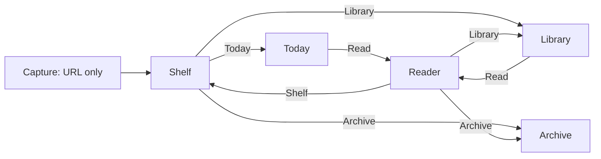

# Focus-First UI Architecture

Status: implemented (Phases A–E complete; reconciled with D5, D11, and D12). Date: 2026-11-26.

This document defines TRAUMA's focus-first shell, browse, and reader surfaces
derived from the ADHD-focus literature in
[`adhd-focus-research.md`](../references/adhd-focus-research.md) and the
measurement rules in
[`adhd-focus-evaluation-protocol.md`](../references/adhd-focus-evaluation-protocol.md).
Its contracts are now reflected in [`ui-and-routing.md`](./ui-and-routing.md),
[`layout-and-shell.md`](../references/design-system/layout-and-shell.md),
[`reader-and-content.md`](../references/design-system/reader-and-content.md),
and [`glossary.md`](../references/glossary.md).

## 1. Problem

The current UI is a social-timeline layout carried over from the foundation
spec ("Responsive X-like shell"):

- A persistent 275px left rail with large pill navigation and an accent
  "Add memory" button, a feed column, and a persistent 360px right rail
  (Flashbacks, Categories, Tags). Both sides of the screen compete with the
  content at all times.
- `/memories` is an infinite feed of post-like cards under `All / Unread /
  Read` tabs. The unread tab turns the collection into visible reading debt.
- The reader sits inside the same three columns. Header, metadata, taxonomy,
  translation controls, table of contents, Flashbacks, Moments, and the
  Psychiatrist dock surround the text.

The four focus plugins shipped so far (`reading-ruler`, `resumption-beacon`,
`adaptive-ai-presenter`, `ephemeral-shelf-triage`) are overlays on this
structure. They cannot fix it, because the bottlenecks the research names
(premature categorization, backlog shame, peripheral clutter, lost place) are
produced by the structure itself.

## 2. Evidence to Decision Map

Each structural decision cites the finding it rests on. Evidence strength is
copied from the research catalog; decisions with only design reasoning are
marked as such.

| # | Decision | Evidence | Strength |
|---|---|---|---|
| D1 | Capture never asks for a category or tag. New items land on a Shelf; classification is deferred until after reading. | Chang et al. CHI '21 (premature categorization cost); Gstell CHI '26 (Shelf vs. Topic groups, d=0.63 lower saving friction) | Strong |
| D2 | Separate *choosing* from *reading*: a short Today list (picked items) is distinct from the Shelf and from the Library. | Gstell CHI '26 (ephemeral vs. long-term structures); catalog plugin 7 (`ephemeral-shelf-triage` cap) | Strong for separation; cap size is a tunable parameter |
| D3 | No unread counts, overdue badges, streaks, or "N items waiting" anywhere. | Protocol §2 Hard Prohibitions; Navneet et al. arXiv '26 (RSD-safe feedback) | Moderate, adopted as a hard rule |
| D4 | Length is shown as a bucket (short / medium / long) and progress as distance traveled (section 3 of 7), never as minutes left. | Navneet et al. arXiv '26 (temporal landmarks instead of countdowns) | Moderate |
| D5 | *(Revised 2026-11-25)* No persistent side rails **and no multi-tab Inspector drawer**. Each secondary reader control is spatially co-located where its need arises and remains hidden during reading: Outline + Marks live in the collapsed left Landmark Rail, Translate lives on `ReaderVariantTabs`, and rare metadata/actions live in a quiet `⋯` top-bar popover. | Llana et al. CHI EA '26 (distraction-free, customizable layouts); Spiel et al. CHI '22 (user control); Ayres & Sweller 2021 / Ginns 2006 / Schroeder & Cenkci 2018 (Split-Attention Effect under constrained working memory) | Strong |
| D6 | The reader is a single column with a bounded measure (default 66ch, range 55–75ch) and user-adjustable type. | Llana et al. CHI EA '26 (speed vs. comprehension trade-off varies by face and size); catalog plugin 10 | Strong for adjustability; the default value is design reasoning |
| D7 | The reader always records the last active paragraph, and Today shows where to continue. | Jo et al. CHI '15 (resumption cues cut resumption lag) | Strong |
| D8 | Prompts (pulse, triage after reading) appear only at article end or on close, never mid-text. | Protocol §2; Navneet et al. arXiv '26 (hyperfocus-safe timing) | Moderate, adopted as a hard rule |
| D9 | Interventions with high individual variance stay plugins, off by default unless graduated by the N-of-1 protocol. | Niklaus et al. CHI '23 (no ruler works for everyone); Moussaoui et al. JINS '25; Snell 2024; Rahman et al. NLP4PI '26 | Strong |
| D10 | Keyboard-first operation with a command palette; mouse paths remain complete. | Design reasoning (fewer visible controls without losing reach) | Design reasoning only |
| D11 | Triage actions use **destination-explicit, self-evident labels** (`Today`, `Shelf`, `Library`, `Archive`) instead of opaque metaphors (`Pick`, `Not now`, `Keep`, `Let go`). No control may require explanatory copy to clarify destination or destructiveness. | Norman/Nielsen recognition-over-recall; Llana et al. CHI EA '26 (ADHD rapid visual scanning increases misread risk on ambiguous copy such as `Let go` vs. *"Let's go"*) | Strong (usability principle + empirical scanning evidence) |
| D12 | Replace the docked Psychiatrist chat tab with a **two-layer post-chat AI architecture**: (1) selection/section-anchored **In-Situ AI Margin Notes** with 1-tap deictic triggers and automatic passage context, and (2) a **Headless Agent API** (`/api/agent/v1/*`) exposing TRAUMA's shared reading state so external agents (e.g., Hermes) and in-reader assistance share one contract. | Joshi & Vogel CHI '26 (AI Margin Notes > chat sidebars; deictic triggers cut mental demand); CHI EA '26 Gaze-to-Context (89% preference for automatic passage grounding); Lo et al. CACM '24 Semantic Reader; Pinto et al. OzCHI '25; Kim & Kim EMNLP '26 ABRA | Strong |

### Epistemic boundary

The literature supports the direction of D1–D9. It does not prove that this
particular layout helps this particular reader. Structural changes cannot be
toggled per session, so they are not evaluated by ATD. Instead:

- Layer 1 passive metrics from the protocol (`completion_rate`,
  `early_bounce_rate`, `session_resumption_ms`, `scroll_back_frequency`) are
  captured for two weeks before the switch and two weeks after it, giving an
  A-B comparison. This is weaker than ABAB and is reported as such.
- Parameters inside the structure (Shelf TTL, Today cap, measure, typography)
  remain plugin or setting values and are evaluated with the protocol's ATD or
  ABAB designs.

## 3. Core vs. Plugin Boundary

Rule: anything that removes noise or makes the app's structure legible is
core. Anything whose benefit differs between people is a plugin.

| Concern | Layer | Note |
|---|---|---|
| Slim shell, no right rail, command palette | Core | D5, D10 |
| Shelf / Today / Library lanes and triage actions | Core | D1, D2 |
| Shelf TTL expiry and Today cap | Plugin `ephemeral-shelf-triage` (parameters) | Off means no expiry and no cap. Evaluated with ABAB (carryover). |
| No debt counters | Core, not configurable | D3 |
| Reader single column, measure tokens, and reading font presets (`Sans`, `Serif`, `Focus`, `Mono`) | Core | D6; font presets live in the Theme popover (`data-reader-font`). |
| Extended typography lab (size, line height, experimental bionic prefix) | Plugin `bionic-typography-lab` | Bionic stays labelled experimental. |
| Last-position persistence | Core | D7; data source for Today and for the beacon. |
| Visual re-entry cue after interruption | Plugin `resumption-beacon` | |
| Landmark rail (outline as section nodes) | Core, collapsed by default | Replaces the right-rail TOC. Breakpoint nudges stay in plugin `temporal-landmark-bar`. |
| Reading ruler, sentence spotlight, skim lens, RSVP | Plugins | Reader overlays. |
| Adapted / Original AI view | Plugin `adaptive-ai-presenter` | Psychiatrist surface. |
| Complexity-gated summary and glossary | Plugin `complexity-gated-scaffold` | Phase 2. |

## 4. Information Architecture

Four modes, each with one job:



- **Capture** stays a URL-only popover, now also reachable from the palette and
  the `a` key. It never asks for taxonomy (D1).
- **Shelf** holds new and undecided items. It is ordered newest first, has no
  count, and supports one-key triage.
- **Today** holds up to N picked items (default 3 when the cap is on). It is
  the default landing view.
- **Library** holds kept and finished items. It is search-first and carries the
  category, tag, and Flashback filters inside its on-demand `Filters` popover.
- **Archive** is a soft state. Archived items are searchable in Library with an
  explicit `in:archive` term and can be restored.

### Routes

The reader routes, `/flashbacks`, `/moments`, `/settings`, and the legacy
redirects are unchanged. `/memories` gains a `lane` key:

```text
/memories                       -> Today (default lane)
/memories?lane=shelf            -> Shelf
/memories?lane=library&q=...&category=...&tag=...&flashback=...&view=list|grid
```

`read` / `unread` search terms keep working in Library for compatibility but are
not offered as tabs.

### Data model

Add to `memories` (one migration, backfilled):

| Column | Type | Meaning |
|---|---|---|
| `triage_state` | text, check in (`shelf`, `today`, `library`, `archive`) | Lane. Backfill: `read = 1` -> `library`, otherwise `shelf`. |
| `triage_changed_at` | timestamp_ms | Last lane change; drives TTL. |
| `last_position` | text (JSON) nullable | `{ variant, headingId, paragraphIndex, scrollRatio, updatedAt }` |
| `last_opened_at` | timestamp_ms nullable | Library sort option and resumption metrics. |

`read` remains and means "finished". TTL expiry is applied lazily when the
Shelf is loaded (no background job, matching the no-job-queue constraint);
expired items move to `archive` only when the plugin's expiry action is
`soft-archive`, otherwise they are grouped under a neutral "Still here"
heading. Lane changes go through one mutation endpoint
`POST /api/memories/:id/triage` with idempotent state transitions.

## 5. Shell

```text
Desktop and Tablet >= 721px
+----+--------------------------------------------+
| 56 |         route canvas (max 920px)           |
| px |  browse: max 720px   reader: measure-bound |
|rail|                                            |
+----+--------------------------------------------+
```

- **Left rail**: fixed 56px icon column on `>= 721px` (`Today`, `Shelf`,
  `Library`, `Flashbacks`, `Moments`, `Settings`, plus `Add`, `Search / Palette`,
  and `Theme` popovers). Labels appear on hover/focus as tooltips. The
  accent-filled "Add memory" pill is removed; Add is a normal icon button. The
  `Theme` popover hosts brightness, surface, and reading font presets (`Sans`,
  `Serif`, `Focus`, `Mono`). Active route keeps the filled icon and, on paper
  themes, the hand-drawn underline moves under the icon.
- **No right rail.** Its contents move: category, tag, and Flashback filters to
  the Library filter popover; TOC and current-memory Marks to the reader
  landmark rail; Flashback shortcuts to Library.
- **Reader mode hides the rail** after the first downward scroll and reveals it
  on pointer approach to the left edge, upward scroll, keyboard focus, or `Esc`.
- **Phone** (`<= 720px`): compact brand header (Search/Palette and Capture) plus
  bottom tabs reduced to `Today`, `Shelf`, `Library`, and `More` (`Flashbacks`,
  `Moments`, `Settings`, `Theme`). Disabled placeholder tabs (Categories, Tags,
  Backup) are removed; dead affordances are noise.
- **Command palette** (`Cmd/Ctrl+K`): search memories by title/URL/taxonomy,
  jump to any route, add a URL, move the focused item between lanes, and toggle
  focus plugins. It reuses the existing browse search backend.
- **Backup failsafe banner** keeps its current precedence; it is a safety
  surface, not decoration.

Visual material (paper and leather themes, tokens) is unchanged. Only
structure and density change.

## 6. Browse Lanes

### Row anatomy (all lanes)

```text
[favicon 20px]  Title (1 line, semibold)                       [ ... ]
                domain · medium · continue at 3/7
```

- No 48px avatar, no description paragraph, no card border; rows are separated
  by spacing and a hairline.
- Length bucket from word count: short < 500, medium 500–1500, long > 1500
  words (the protocol's buckets).
- "continue at 3/7" appears only when `last_position` exists, as distance
  traveled (D4, D7).
- Taxonomy chips are hidden in Today and Shelf and shown in Library.

### Today

- Up to N rows. When the cap is reached, moving an item to `Today` is disabled
  with the neutral text "Today is full. Finish or return one first."
- Empty state: "Nothing picked. Choose from the Shelf when you're ready." with
  a link to the Shelf (`Open Shelf`). No encouragement copy, no counts.
- Primary action per row: open in Reader (`Enter`). Secondary triage actions:
  `Shelf` (return to Shelf), `Archive` (`x`).

### Shelf

- Newest first, cursor-paginated, no total.
- Visible row controls use destination labels: `Today`, `Library`, `Archive`
  (D11).
- Keys: `j`/`k` (or arrow keys) move, `p` -> `Today`, `l` -> `Library`,
  `x` -> `Archive`, `Enter` open in Reader, `u` undo the last triage action
  (toast with Undo for 6s, no confirmation dialogs for reversible actions).
- Items past TTL render under "Still here" (or are soft-archived, per plugin
  setting). Never red, never a number.

### Library

- Search field first, then a single "Filters" button opening a popover with
  categories, tags, Flashback filter, `in:archive`, and sort (recent, last
  opened).
- List/grid stays URL-addressable.

## 7. Reader

```text
| landmark rail   |      text column (measure 66ch)      |  (optional in-situ    |
| (collapsed,     |  title                               |   AI margin card      |
|  outline+marks) |  domain · long · source / ja + [⋯]   |   anchored to text)   |
|                 |  ...body...                          |                       |
|                 |  ---- end of article ----            |                       |
|                 |  [Library] [Archive] [Shelf]         |                       |
```

- **Top bar** (auto-hides on downward scroll, returns on upward scroll):
  back, title (truncated), `ReaderVariantTabs` (with an inline `+ Translate`
  popover co-located on the language switcher), and a quiet `⋯` overflow
  popover for rare metadata/management actions (URL, captured date, categories,
  tags, read state, delete). No `Inspector` button and no 5-tab side drawer
  (revised D5).
- **Text column**: measure token `--reader-measure` (default 66ch; CJK
  languages override via `:lang(ja)` / `:lang(zh)` and `:lang(ko)`), body size,
  line-height, and selectable reading font presets (`Sans`, `Serif`, `Focus`,
  `Mono`) from tokens. Opening any popover, landmark panel, margin card, or
  the on-demand Psychiatrist sheet never shifts the column width or horizontal
  position.
- **Landmark rail**: a thin column of section nodes on the left; nodes up to
  the current section are filled (distance traveled). Hover or focus expands it
  into the unified outline + marks jump list (TOC headings, Moments, and
  current-memory Flashbacks mapped to document order). Reuses
  `toc-scroll-spy.ts` / `toc-reading-range.ts`.
- **Selection & In-Situ AI Margin Notes** (D12): selecting text opens the
  reader selection menu with `Flashback` (and `Moment` when a section applies)
  plus 1-tap deictic AI actions (`Simplify`, `Explain`, `Ask`). Activating an
  AI action attaches the selected passage, surrounding section, and memory
  metadata automatically and renders an **in-situ margin card** (or compact
  bottom sheet on narrow viewports) showing the passage snippet and output
  formatted through `adaptive-ai-presenter`. Readers can ask a follow-up,
  dismiss the card (`Escape` or Close), or explicitly escalate via
  `Continue in Psychiatrist` to the on-demand Psychiatrist sheet (also toggled
  with `]`; see AC 15 for the full entry contract). No chat sidebar is docked
  by default.
- **Headless Agent API** (D12): `/api/agent/v1/*` (`GET /context`,
  `GET /memories/:id`, `POST /memories/:id/triage`, `POST /memories/:id/ask`)
  exposes TRAUMA's shared reading state (memories, reading `last_position`,
  Flashbacks, Moments, triage lanes, and in-situ query execution) over JSON
  REST + SSE so external agents (Hermes, CLI tools, custom clients) operate on
  the exact same contract as the reader UI.
- **Position**: core saves `last_position` on paragraph change (debounced 2s),
  on `visibilitychange: hidden`, and on route leave. Reopen restores the
  position silently; the resumption plugin adds the visual cue.
- **End of article**: a quiet footer offers destination-explicit triage
  controls (`Library`, `Archive`, `Shelf` — D11) and, if focus plugins or the
  experiment log are active, the 3-state pulse. This is the only place the
  reader asks anything (D8). Reaching 75% depth with >= 20s dwell marks `read`
  automatically (the protocol's completion definition), reversible in the `⋯`
  menu.

## 8. Plugin Surfaces After the Redesign

`FocusPluginSurface` keeps its values; mount points change:

| Surface | Mount point | Plugins |
|---|---|---|
| `reader` | overlay layer above the text column | reading-ruler, sentence spotlight, skim lens, RSVP, typography lab, resumption-beacon, temporal-landmark-bar nudges |
| `psychiatrist` | in-situ AI margin card (and escalated thread view) | adaptive-ai-presenter |
| `browse` | Shelf and Today lane controllers | ephemeral-shelf-triage (TTL, cap) |
| `global` | command palette and Settings > Focus | plugin toggles, experiment log |

`EphemeralShelfBar` is removed; its function becomes the Shelf lane itself,
with the plugin supplying only TTL and cap parameters.

## 9. Accessibility and Motion

- Every keyboard action has a visible control; shortcuts are listed in the
  palette and in Settings.
- Auto-hide chrome never traps focus: keyboard focus entering the top bar or
  rail reveals it.
- `prefers-reduced-motion` disables slide and fade transitions (top bar,
  landmark rail, Psychiatrist sheet, rail reveal, beacon fade) and shows end
  states.
- Reader popovers (`Translate`, `⋯` details and actions) and the on-demand
  Psychiatrist sheet are dialogs (`role="dialog"`) with focus return on close;
  in-situ margin notes dismiss with `Escape` and return focus; browse lanes use
  `role="list"` with roving tabindex.

## 10. Acceptance Criteria

Each item is checked by an automated test (Vitest for units, Playwright for
routes) before the phase is accepted. The machine-checked manifest
`tests/contracts/focus-first-ui.contract.ts` (verified by
`tests/contracts/focus-first-ui-contract.test.ts`) is the binding between each
criterion below and its test file and title.

1. At 1280x800 no element wider than 80px exists to the right of the main
   canvas on `/memories` (right rail removed).
2. No visible text on `/memories` in any lane matches a count of items
   (regex check over rendered text for `\d+ (unread|items|memories|left|waiting)`
   and numeric badges); Library taxonomy counts appear only inside the Filters
   popover.
3. Saving a URL creates a row with `triage_state = 'shelf'` and never opens a
   taxonomy prompt.
4. `p`, `l`, `x`, `u` on a focused Shelf row persist the expected
   `triage_state` and survive reload; moving to `Today` is refused when Today
   is at cap.
5. Reader text column computed width is <= 75ch and >= 55ch at 1280px and at
   1920px, and its width and horizontal position do not change when any reader
   micro-surface (landmark rail, Translate popover, `⋯` overflow popover,
   margin note card, or Psychiatrist sheet) opens.
6. Reloading a reader after scrolling to section 4 restores the same heading
   in the viewport and Today shows "continue at 4/N".
7. No dialog, toast, or prompt appears in the reader before the end footer is
   in view or the reader is closed.
8. `Cmd/Ctrl+K` opens the palette from every route; search, navigation, add
   URL, and plugin toggles work from it.
9. Phone viewport shows exactly four bottom tabs and no disabled tabs.
10. axe-core reports no serious or critical violations on Today, Shelf,
    Library, and the reader with its micro-surfaces (Details popover, Translate
    popover, and Psychiatrist sheet) closed and open.
11. Migration backfills existing rows (`read` -> `library`, others -> `shelf`)
    and is covered by the existing cross-process migration tests.
12. The reader renders no `Inspector` control and no tabbed side drawer; rare
    metadata and management actions live inside the quiet `⋯` overflow popover.
13. No rendered control text matches `Pick`, `Not now`, `Keep`, or `Let go`;
    triage controls are named by destination (`Today`, `Shelf`, `Library`,
    `Archive`).
14. Selecting reader text offers `Simplify`, `Explain`, and `Ask`, and
    activating one renders an in-situ margin card containing the selected
    passage snippet while no chat surface is open by default.
15. The Psychiatrist thread opens from a visible control in the reader overflow
    popover, from the command palette (`Open Psychiatrist`) on reader routes,
    and with the `]` key, and closing it returns focus to the invoking control.
16. The `/api/agent/v1` endpoints return the documented JSON shapes and respond
    `401` for a wrong bearer token when `TRAUMA_API_TOKEN` is configured.

## 11. Delivery Phases

| Phase | Scope | Exit |
|---|---|---|
| A | Data: migration, triage endpoint, `last_position` writes, repository and API tests, headless `/api/agent/v1` endpoints | AC 3, 4 (API level), 11, 16 |
| B | Shell: slim rail, right rail removal, command palette, phone tabs | AC 1, 8, 9 |
| C | Browse lanes: Today, Shelf, Library, row anatomy, destination triage labels and keys | AC 2, 4 (UI), 13 |
| D | Reader: canvas, landmark rail, co-located popovers (`+ Translate`, `⋯`), in-situ AI margin notes, on-demand Psychiatrist sheet, end footer, position restore | AC 5, 6, 7, 12, 14, 15 |
| E | Plugin re-mount, remove `EphemeralShelfBar`, accessibility pass, docs (`ui-and-routing.md`, design-system shell and reader docs, glossary) | AC 10, all green |

Phases A and B are independent. C depends on A and B. D depends on A and B.
E closes after C and D. Baseline passive metrics should be recorded for two
weeks before B ships to users (see §2 Epistemic boundary).

## 12. Defaults Chosen Without Owner Input

These were decided to keep work moving; each is a parameter or a small change
if the owner prefers otherwise.

- Today cap default 3, Shelf TTL default off (plugin decides).
- Measure default 66ch.
- Landing view is Today.
- Phone "More" tab instead of a fifth tab.
- Auto-mark `read` at the protocol's completion threshold, reversible.
- Isolated verification output directory: `.output-verify/`.
- Verification-plus-e2e script name: `verify:full` (verify, then Playwright).
- Shelf keys `p`, `l`, `x`, `u` stay as they are; the document names each next
  to the destination label it triggers (`Today`, `Library`, `Archive`, Undo)
  instead of adding aliases.
- Palette command label for escalating to Psychiatrist: `Open Psychiatrist`,
  listed only on reader routes (AC 15).
- The AC-to-test contract manifest lives in `tests/contracts/` and matches tests
  by title substring.
- `lengthBucket` in the agent API: derived when the word count is available in
  the row, otherwise documented as nullable.
